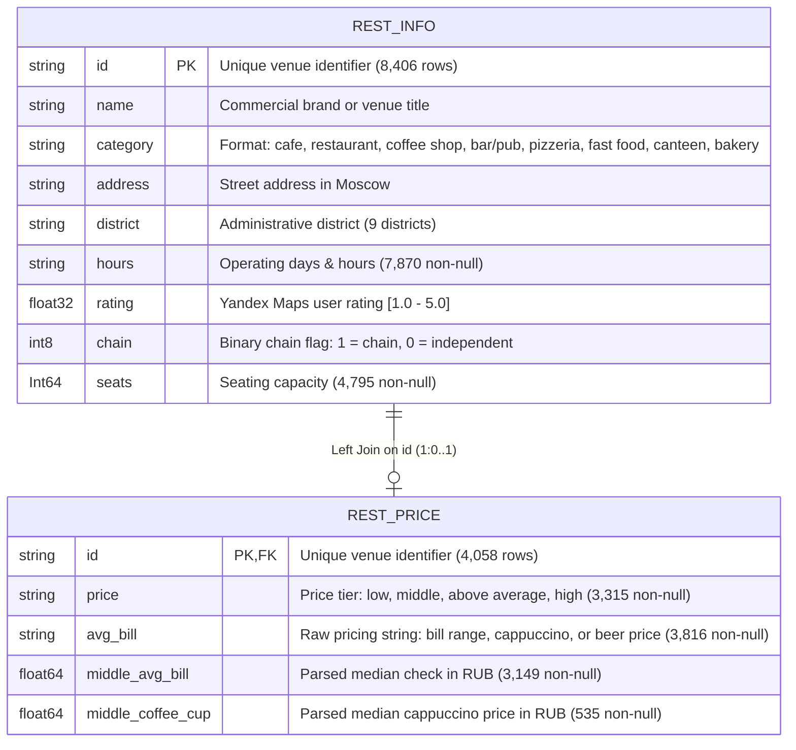

<div align="center">

# Moscow Food Service Market: Exploratory Analysis & Investment Insights

**End-to-end exploratory data analysis, data quality auditing, and location-pricing strategy across 8,406 catering venues in Moscow**

[**English**](README.md) | [**Русский**](README.ru.md)


</div>

---

## 📌 Executive Summary

**Business Objective:** Evaluate the structural, geographic, and pricing landscape of Moscow's food service industry, identify operational factors associated with high customer ratings, and formulate empirical market-entry recommendations for prospective investors.

**Methodology:** Integrated and audited **8,406 venue records** alongside **4,058 pricing records** (Summer 2022 Yandex Maps & Yandex Business snapshot). Conducted rigorous data quality diagnostics (missingness, upstream parsing verification, and outlier scrubbing), engineered schedule features, and evaluated multivariate relationships using non-parametric statistics and $\phi_k$ (`phik`) correlation analysis.

### Key Analytical & Technical Achievements
* **Upstream Parsing Artifact Elimination:** Refuted the initial hypothesis that extreme capacities (>700 seats) were banquet halls; uncovered a probable scraping bug where a shopping mall food-court capacity (`1,288 seats`) was duplicated across small coffee kiosks and dark kitchens, scrubbing the contaminated values without losing venue metadata.
* **Evidence-Based Missing Data Recovery:** Diagnosed a strict hierarchical dependency in financial attributes and deterministically recovered **~20% of missing qualitative `price` tiers** via vectorized quartile binning (`pd.cut`) of numeric bills.
* **Counterintuitive Rating Drivers ($\phi_k$ Analysis):** Proved that user ratings are tightly compressed (`IQR: 4.1–4.4`, `median: 4.30`) and have virtually zero association with physical seating capacity ($\phi_k = 0.00$) or chain status ($\phi_k = 0.09$). Instead, ratings are primarily associated with **price tier ($\phi_k = 0.29$)** and **venue format ($\phi_k = 0.22$)**, with bars/pubs leading (`4.39`) and fast food lagging (`4.05`).
* **Geographic Arbitrage Discovery:** Demonstrated that while the Central District (CAO) concentrates **>25% of all venues** (2.5x more than any other district), the **Western Administrative District (ZAO)** achieves the exact same top median check (**~1,000 RUB**) at less than half the competitive saturation.

---

## 📊 Visual Highlights

### 1. Geographic Concentration & Central District (CAO) Format Shift
Over a quarter of Moscow's entire catering market is crowded into the Central District (CAO), where demand shifts away from neighborhood cafes toward full-service restaurants (`~30%`) and nightlife bars/pubs (`~16%`). Conversely, the North-Western District (SZAO) represents only `~5%` of venues.


### 2. Seating Capacity Distribution vs. Missingness Constraints
Observed venues are predominantly compact (<100 seats, with medians ranging from `50` in bakeries to `86` in restaurants). By pairing interquartile error bars ($Q_1 - Q_3$) with category-level missingness rates (`32.7%–48.9%`), the analysis avoids over-generalizing sample medians to the broader population.


### 3. Multivariate Rating Correlates ($\phi_k$) & Price-Tier Gradient
Non-linear $\phi_k$ correlation across mixed data types confirms that structural scale (`seats`, `chain`) does not drive customer loyalty. Higher price tiers exhibit both higher median ratings (`~4.4`) and tighter upper-quartile stability compared to budget formats (`~4.2`).


### 4. Regional Pricing Power Across Administrative Districts
While fine-dining venues in CAO are counterbalanced by small establishments, affluent residential clusters in ZAO (Ramenki, Krylatskoye, Dorogomilovo) sustain a matching `~1,000 RUB` median check.


---

## 🗄️ Data Architecture & Governance Notice

> **⚠️ Data Privacy & Availability Notice:** The raw datasets (`rest_info.csv` and `rest_price.csv`) are proprietary educational materials (compiled from Yandex Maps and Yandex Business directory snapshots, Summer 2022) and cannot be publicly redistributed in this repository. Below is the complete relational schema and parsing architecture used by the analysis pipeline.

### Relational Schema & Feature Hierarchy



### Financial Feature Parsing & Imputation Pipeline

During data validation (Section 4.4), we proved a 100% deterministic parsing hierarchy originating from `avg_bill` and implemented a non-leaking recovery pipeline for `price`:

```mermaid
flowchart LR
    A["Raw String: avg_bill<br/>(3,816 non-null)"] -->|Contains 'Средний счёт'| B["Numeric: middle_avg_bill<br/>(3,149 rows, 100% parsed)"]
    A -->|Contains 'Цена одной чашки капучино'| C["Numeric: middle_coffee_cup<br/>(535 rows, 100% parsed)"]
    A -->|Other item strings<br/>(e.g., glass of beer)| D["Unparsed Item Strings<br/>(132 rows)"]
    
    B -->|Quartile Binning via pd.cut<br/>(<300, 300-1000, 1000-1600, >=1600 ₽)| E["Recovered 'price' Tier<br/>(~20% missingness recovered)"]
    C -.->|63.5% populated in Low-Price tier| F["Coffee Shop ('кофейня') Cluster<br/>(Hypothesis H1 Confirmed)"]
```

---

## 💡 Strategic Recommendations for Investors

1. **Target ZAO for Upper-Mid-Tier Concepts & SZAO for Low-Competition Entry:** ZAO matches CAO's `~1,000 RUB` median check with less than half the competitive density. SZAO (`~5%` market share) offers the lowest saturation, provided local transit/pedestrian foot traffic is validated first.
2. **Align Ownership Structure with Format Economics:** Multi-unit franchise or chain models should focus on standardized workflows (**bakery, pizzeria, coffee shop, fast food**). Single-venue independent investors should target **experiential bars/pubs**, which resist chain consolidation and achieve the highest average rating (`4.39`).
3. **Calibrate Pricing to Local Purchasing Power:** Do not apply citywide averages (`750 RUB` median) uniformly. Concepts launching in price-sensitive districts like **YUVAO** (`<500 RUB` median check) require lean cost structures.
4. **Focus on Execution Over Scale:** Neither seating capacity ($\phi_k = 0.00$) nor chain branding ($\phi_k = 0.09$) guarantees high ratings. Moreover, because ratings are correlational, raising prices without matching culinary/service standards will not lift user scores.

---

## 📂 Repository Structure & Reproducibility

```text
├── README.md                                        # English documentation (Current view)
├── README.ru.md                                     # Russian documentation
├── requirements.txt                                 # Python environment dependencies
├── notebooks/
│   └── 01_moscow_catering_market_analysis.ipynb     # Full end-to-end Jupyter Notebook with outputs
└── reports/
    ├── moscow_catering_report.pdf                   # Exported executive report
    └── figures/                                     # High-resolution charts for README
```

### Quick Start
1. Clone the repository and install dependencies:
   ```bash
   git clone https://github.com/YOUR_USERNAME/moscow-catering-market-analysis.git
   cd moscow-catering-market-analysis
   pip install -r requirements.txt
   ```
2. Place `rest_info.csv` and `rest_price.csv` into a local `datasets/` directory (the notebook automatically resolves `/datasets/` or `datasets/` via `os.path.exists`).
3. Run `notebooks/01_moscow_catering_market_analysis.ipynb` top-to-bottom (`Kernel -> Restart & Run All`).