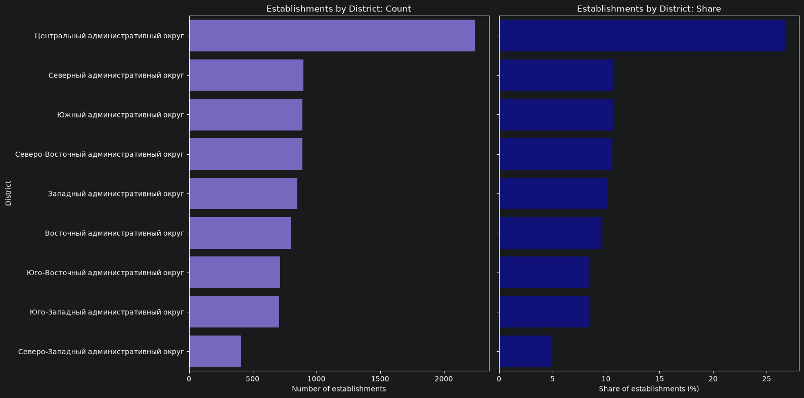
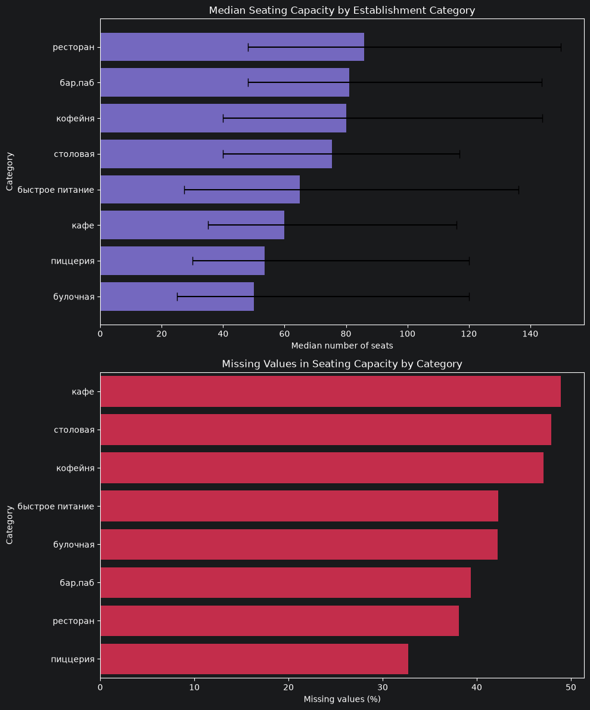
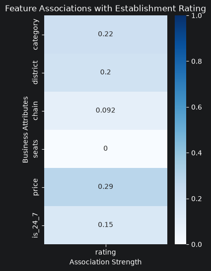
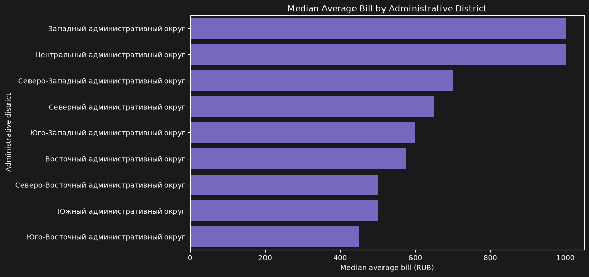
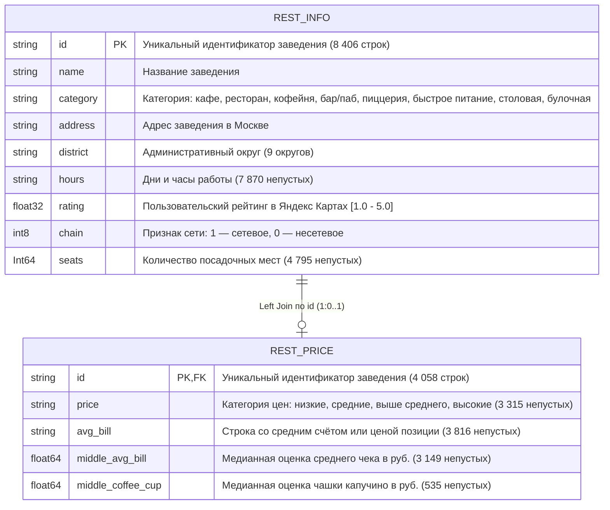

<div align="center">

# Рынок общественного питания Москвы: исследовательский анализ и инвестиционные инсайты

**Комплексный исследовательский анализ данных (EDA), аудит качества данных и разработка продуктово-локационной стратегии на базе 8 406 заведений Москвы**

[**English**](README.md) | [**Русский**](README.ru.md)


</div>

---

## 📌 Резюме проекта (Executive Summary)

**Бизнес-цель:** Изучить структурные, географические и ценовые закономерности рынка общественного питания Москвы, выявить операционные факторы, связанные с высокими пользовательскими оценками, и сформулировать рекомендации для инвесторов при выборе формата и локации нового заведения.

**Методология:** Объединены и провалидированы данные о **8 406 заведениях** и **4 058 ценовых записях** (срез Яндекс Карт и Яндекс Бизнеса на лето 2022 года). Проведена глубокая диагностика качества данных (анализ пропусков, аудит регулярности парсинга, очистка аномальных значений и неявных дубликатов), сконструирован признак круглосуточной работы `is_24_7` и выполнен многомерный анализ нелинейных связей с помощью непараметрической статистики и коэффициента корреляции $\phi_k$ (`phik`).

### Ключевые технические и аналитические достижения
* **Выявление и очистка технического бага парсинга:** Опровергнута первичная гипотеза о том, что экстремальная вместимость (>700 мест) принадлежит банкетным залам; обнаружен вероятный системный артефакт сбора данных, при котором общая вместимость фудкорта ТЦ (`1 288 мест`) была ошибочно присвоена десяткам малых кофеен и дарк-китченов. Аномалии точечно переведены в `NaN` без потери карточек заведений.
* **Доказательное восстановление пропусков без искажения распределений:** Установлена жесткая иерархическая зависимость финансовых признаков. С помощью векторной квантильной разбивки (`pd.cut`) по известному среднему чеку восстановлено **~20% пропусков в ценовых категориях (`price`)**.
* **Контринтуитивные драйверы рейтинга ($\phi_k$ анализ):** Доказано, что пользовательские оценки жестко сжаты в узком диапазоне (`IQR: 4.1–4.4`, `медиана: 4.30`) и практически не зависят от физического размера заведения (`seats`, $\phi_k = 0.00$) или сетевого статуса (`chain`, $\phi_k = 0.09$). Наиболее сильная связь с рейтингом наблюдается у **ценового сегмента ($\phi_k = 0.29$)** и **категории заведения ($\phi_k = 0.22$)**, где лидируют бары и пабы (`4.39`), а замыкают рейтинг точки фастфуда (`4.05`).
* **Географический ценовой арбитраж:** Показано, что хотя Центральный округ (ЦАО) аккумулирует **более 25% всех заведений города** (в 2.5 раза больше любого другого округа), **Западный административный округ (ЗАО)** демонстрирует точно такой же лидерский медианный чек (**~1 000 ₽**) при более чем двукратно меньшей плотности конкурентов.

---

## 📊 Ключевые визуализации

### 1. Географическая концентрация и смещение форматов в ЦАО
Более четверти всего рынка Москвы сосредоточено в ЦАО, где структура спроса смещается от обычных кафе к полносервисным ресторанам (`~30%`) и барам/пабам (`~16%`), вытесняя бюджетные форматы. Напротив, СЗАО занимает лишь `~5%` рынка.



### 2. Вместимость заведений с учетом ограничений полноты данных
Большинство наблюдаемых заведений компактны (до 100 посадочных мест; медианы от `50` мест в булочных до `86` в ресторанах). Совмещение межквартильного размаха ($Q_1 - Q_3$) с графиком доли пропусков (`32.7%–48.9%`) наглядно демонстрирует границы применимости выборочных медиан.



### 3. Матрица корреляции $\phi_k$ и распределение рейтингов по ценам
Нелинейный коэффициент $\phi_k$ для смешанных типов данных подтверждает отсутствие связи между масштабом бизнеса (`seats`, `chain`) и оценками гостей. Заведения высокого ценового сегмента отличаются более высокой медианой рейтинга (`~4.4`) и стабильностью оценок по сравнению с бюджетным сегментом (`~4.2`).



### 4. Региональная покупательская способность по округам Москвы
В ЦАО чеки премиальных ресторанов уравновешиваются мелкими точками, в то время как престижные жилые районы ЗАО (Раменки, Крылатское, Дорогомилово) формируют аналогичный медианный чек в `~1 000 ₽`.



---

## 🗄️ Архитектура данных и условия использования

> **⚠️ Доступность данных (Data Governance):** Исходные файлы (`rest_info.csv` и `rest_price.csv`) являются учебными датасетами и являются частью курса (собраны на основе открытых справочников Яндекс Карт и Яндекс Бизнеса на лето 2022 года) и не публикуются в открытом доступе. Ниже приведена полная схема данных и логика их парсинга.

### Реляционная схема таблиц



### Иерархия парсинга финансовых признаков и пайплайн восстановления `price`

На этапе предобработки (Раздел 4.4) была доказана 100%-ная точность извлечения числовых метрик из корневого поля `avg_bill` и реализован алгоритм восстановления ценовых сегментов:

```mermaid
flowchart LR
    A["Исходная строка: avg_bill<br/>(3 816 непустых)"] -->|Подстрока 'Средний счёт'| B["Число: middle_avg_bill<br/>(3 149 строк, 100% парсинг)"]
    A -->|Подстрока 'Цена одной чашки капучино'| C["Число: middle_coffee_cup<br/>(535 строк, 100% парсинг)"]
    A -->|Прочие позиции<br/>(напр., цена бокала пива)| D["Нецелевые строки<br/>(132 строки)"]
    
    B -->|Квантильная разбивка pd.cut| E["Восстановленный 'price'<br/>(~20% пропусков закрыто)"]
    C -.->|Заполнено у 36.5% в сегменте 'низкие'| F["Кластер 'кофейня'"]
```

---

## 💡 Стратегические рекомендации для инвесторов

1. **Фокус на ЗАО для концепций «средний+» и СЗАО для входа с низкой конкуренцией:** ЗАО обеспечивает медианный чек на уровне ЦАО (`~1 000 ₽`) при более чем двукратно меньшей плотности конкурентов. СЗАО (`~5%` заведений Москвы) — перспективная точка роста при условии предварительного замера пешеходного трафика.
2. **Выбор бизнес-модели под формат:** Для запуска масштабируемой сети следует выбирать форматы со стандартизируемыми процессами (**булочная, пиццерия, кофейня, фастфуд**). Для открытия независимого авторского проекта оптимален сегмент **баров и пабов**, где сети представлены слабо, а средний рейтинг максимален (`4.39`).
3. **Калибровка цен под экономику конкретного округа:** Опасно ориентироваться на общегородскую медиану (`750 ₽`). В чувствительных к цене округах, таких как **ЮВАО** (медианный чек `<500 ₽`), финансовая модель должна опираться на низкую себестоимость.
4. **Приоритет качества исполнения над масштабом:** Вместимость ($\phi_k = 0.00$) и сетевая вывеска ($\phi_k = 0.09$) не гарантируют высоких оценок. А поскольку связь цены и рейтинга ($\phi_k = 0.29$) не является причинно-следственной, повышение цен без соответствующего уровня кухни и сервиса не приведет к росту лояльности.

---

## 📂 Структура репозитория и запуск

```text
├── README.md                                        # Документация на английском языке
├── README.ru.md                                     # Документация на русском языке (текущий файл)
├── LICENSE                                          # Лицензия
├── requirements.txt                                 # Зависимости окружения Python
├── notebooks/
│   └── 01_moscow_catering_market_analysis.ipynb     # Полный Jupyter Notebook с кодом и графиками
└── reports/
    ├── moscow_catering_report.pdf                   # Экспортированный отчёт в формате PDF
    └── figures/                                     # Графики высокого разрешения для витрины README
```

### Быстрый старт
1. Клонируйте репозиторий и установите зависимости:
   ```bash
   git clone https://github.com/YOUR_USERNAME/moscow-catering-market-analysis.git
   cd moscow-catering-market-analysis
   pip install -r requirements.txt
   ```
2. Поместите локальные копии `rest_info.csv` и `rest_price.csv` в папку `datasets/` в корне проекта.
3. Запустите `notebooks/01_moscow_catering_market_analysis.ipynb` (`Kernel -> Restart & Run All`).